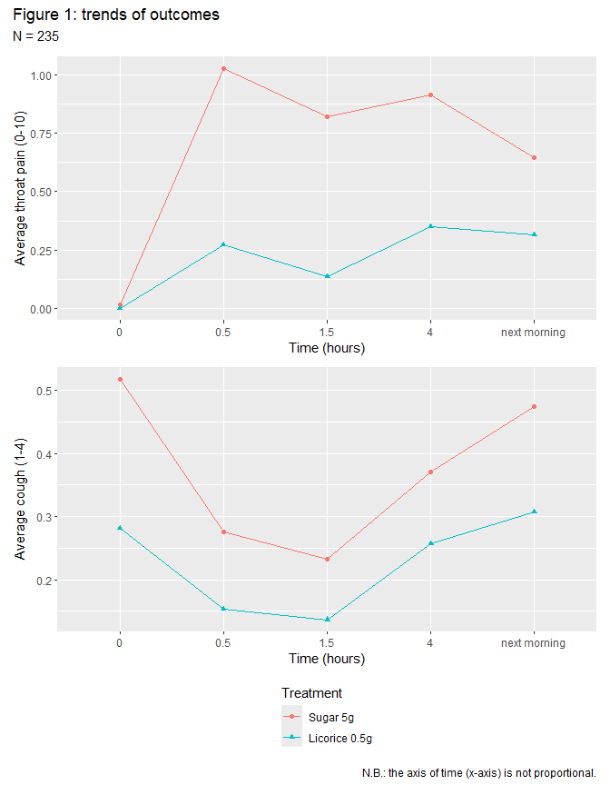

Preoperative licorice reduces complications of intubation
================
Tristan Tangdiongga
2026-11-25


## Introduction

In this document, a dataset from a randomized controlled trial (RCT)
about the effect of licorice gargle preoperatively will be analysed.

## Prerequisites

The dataset that was used is the `licorice_gargle` dataset from the
`medicaldata` library. Furthermore, the packages `tidyverse` and
`gtsummary` were used for the data manipulation and statistical
analysis, respectively. Lastly, the package `patchwork` was used for the
formatting of the figures.

``` r
library(tidyverse)
library(gtsummary)
library(patchwork)

library(medicaldata)
lic <- licorice_gargle
```

## Descriptive statistics

The descriptive statistics of this dataset is given in table 1. 236
adult patients undergoing elective thoracic surgery requiring a
double-lumen endotracheal tube were included. Patients were randomized
to placebo (sugar 5g) and licorice (0.5g). No significant differences in
demographics were reported.

The table was made with the `tbl_summary()` function of the `gtsummary`
package.

## Outcomes

The outcomes that were analyzed are cough, sore throat and pain
swallowing at various time points. These are shown in table 2.
Furthermore, the outcomes were plotted against the time, shown in figure
1.

The table was made with the `tbl_summary()` function of the `gtsummary`
package. The figures were made with the `ggplot()` function of the
`tidyverse` package, together with `patchwork`.

## Conclusion

Preoperative licorice reduces the postoperative cough, throat pain (p \<
0.01) and swallow pain (p \< 0.001) after intubation.

| **Characteristic** | **Sugar 5g** (N = 117) | **Licorice 0.5g** (N = 118) | **p-value** |
|:---|:--:|:--:|:--:|
| Gender |  |  | 0.5 |
| Female | 44 (38%) | 49 (42%) |  |
| Male | 73 (62%) | 69 (58%) |  |
| ASA |  |  | 0.9 |
| 1 | 19 (16%) | 22 (19%) |  |
| 2 | 67 (57%) | 67 (57%) |  |
| 3 | 31 (26%) | 29 (25%) |  |
| BMI | 25.6 (25, 26) | 25.6 (25, 26) | 0.8 |
| Age | 58 (55, 61) | 57 (54, 59) | 0.5 |
| Mallampati |  |  | 0.5 |
| 1 | 31 (26%) | 39 (33%) |  |
| 2 | 69 (59%) | 66 (56%) |  |
| 3 | 16 (14%) | 13 (11%) |  |
| 4 | 1 (0.9%) | 0 (0%) |  |
| Smoking |  |  | \>0.9 |
| Current | 45 (38%) | 45 (38%) |  |
| Never | 36 (31%) | 37 (31%) |  |
| Past | 36 (31%) | 36 (31%) |  |
| Preoperative pain | 2 (1.7%) | 0 (0%) | 0.2 |

Demographics characteristics by randomized group

| **Outcome** | **Sugar 5g** (N = 117) | **Licorice 0.5g** (N = 118) | **p-value** |
|:---|:--:|:--:|:--:|
| **Intra-op** |  |  |  |
| Surgery size |  |  | 0.5 |
| Small | 24 (21%) | 32 (27%) |  |
| Medium | 83 (71%) | 75 (64%) |  |
| Large | 10 (8.5%) | 11 (9.3%) |  |
| Extubation cough |  |  | 0.012 |
| No cough | 71 (61%) | 88 (75%) |  |
| Mild | 30 (26%) | 25 (21%) |  |
| Moderate | 15 (13%) | 4 (3.4%) |  |
| Severe | 0 (0%) | 0 (0%) |  |
| **30m post-op** |  |  |  |
| Cough |  |  | 0.063 |
| No cough | 88 (76%) | 99 (85%) |  |
| Mild | 24 (21%) | 18 (15%) |  |
| Moderate | 4 (3.4%) | 0 (0%) |  |
| Severe | 0 (0%) | 0 (0%) |  |
| Throat pain (0-10) | 1.03 (0.74, 1.3) | 0.27 (0.15, 0.40) | \<0.001 |
| Swallow pain (0-10) | 1.38 (0.96, 1.8) | 0.31 (0.16, 0.46) | \<0.001 |
| **90m post-op** |  |  |  |
| Cough |  |  | 0.13 |
| No cough | 91 (78%) | 101 (86%) |  |
| Mild | 23 (20%) | 16 (14%) |  |
| Moderate | 2 (1.7%) | 0 (0%) |  |
| Severe | 0 (0%) | 0 (0%) |  |
| Throat pain (0-10) | 0.82 (0.58, 1.1) | 0.14 (0.05, 0.22) | \<0.001 |
| **4h post-op** |  |  |  |
| Cough |  |  | 0.3 |
| No cough | 77 (66%) | 89 (76%) |  |
| Mild | 35 (30%) | 26 (22%) |  |
| Moderate | 4 (3.4%) | 2 (1.7%) |  |
| Severe | 0 (0%) | 0 (0%) |  |
| Throat pain (0-10) | 0.91 (0.66, 1.2) | 0.35 (0.21, 0.49) | \<0.001 |
| **1st morning post-op** |  |  |  |
| Cough |  |  | 0.084 |
| No cough | 68 (59%) | 86 (74%) |  |
| Mild | 42 (36%) | 27 (23%) |  |
| Moderate | 5 (4.3%) | 3 (2.6%) |  |
| Severe | 1 (0.9%) | 1 (0.9%) |  |
| Throat pain (0-10) | 0.65 (0.46, 0.83) | 0.32 (0.19, 0.44) | 0.002 |

Outcomes by randomized group

<!-- -->
